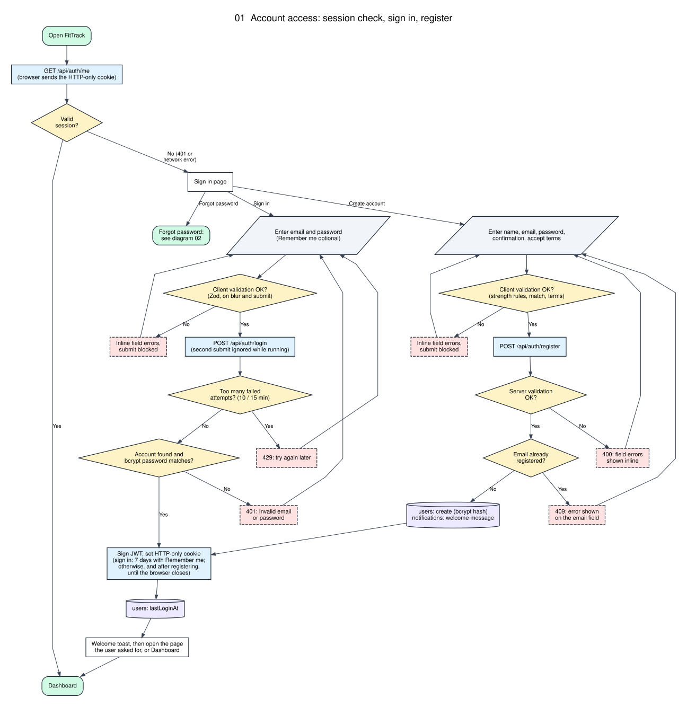
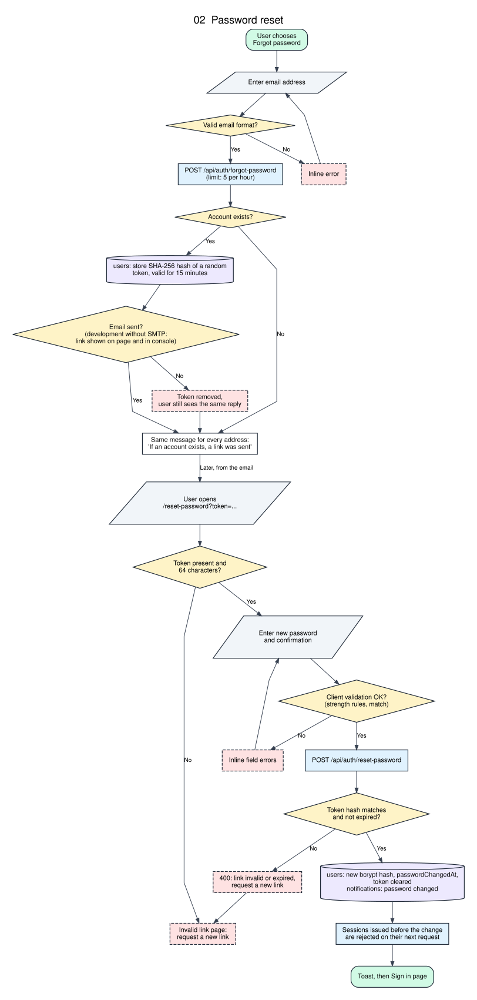
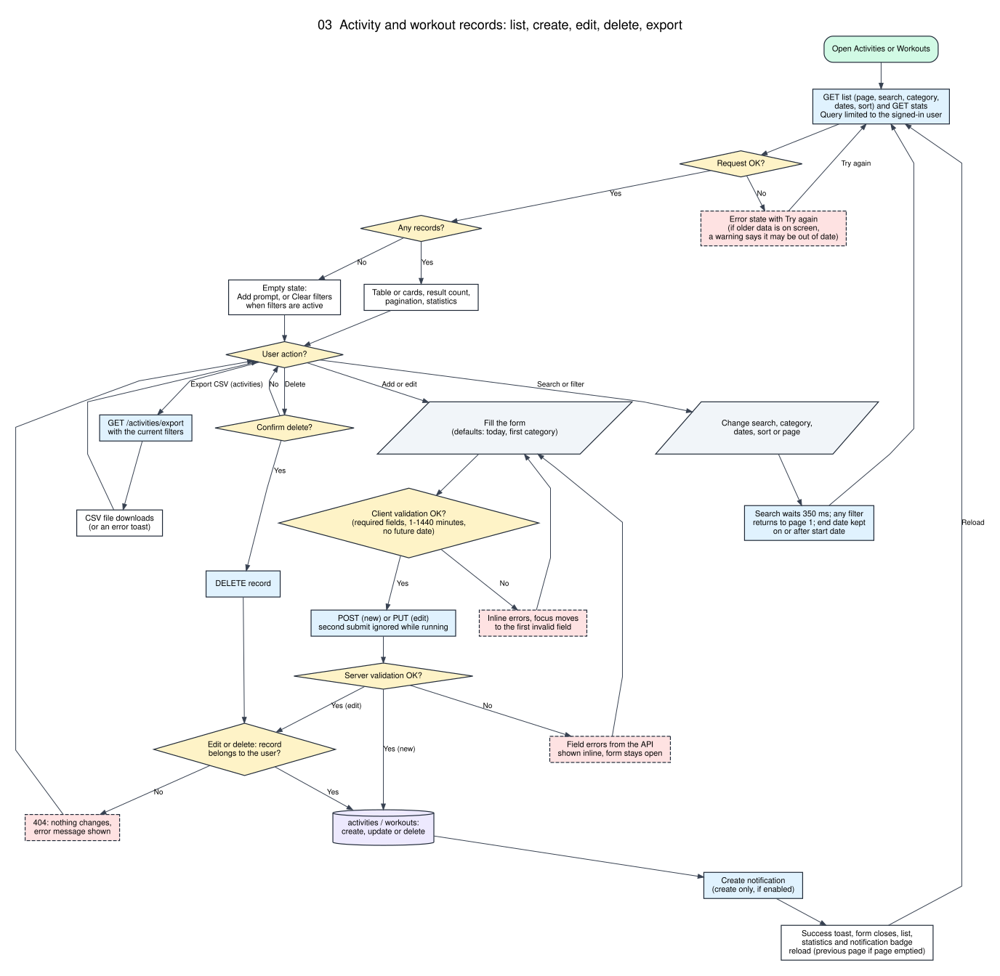
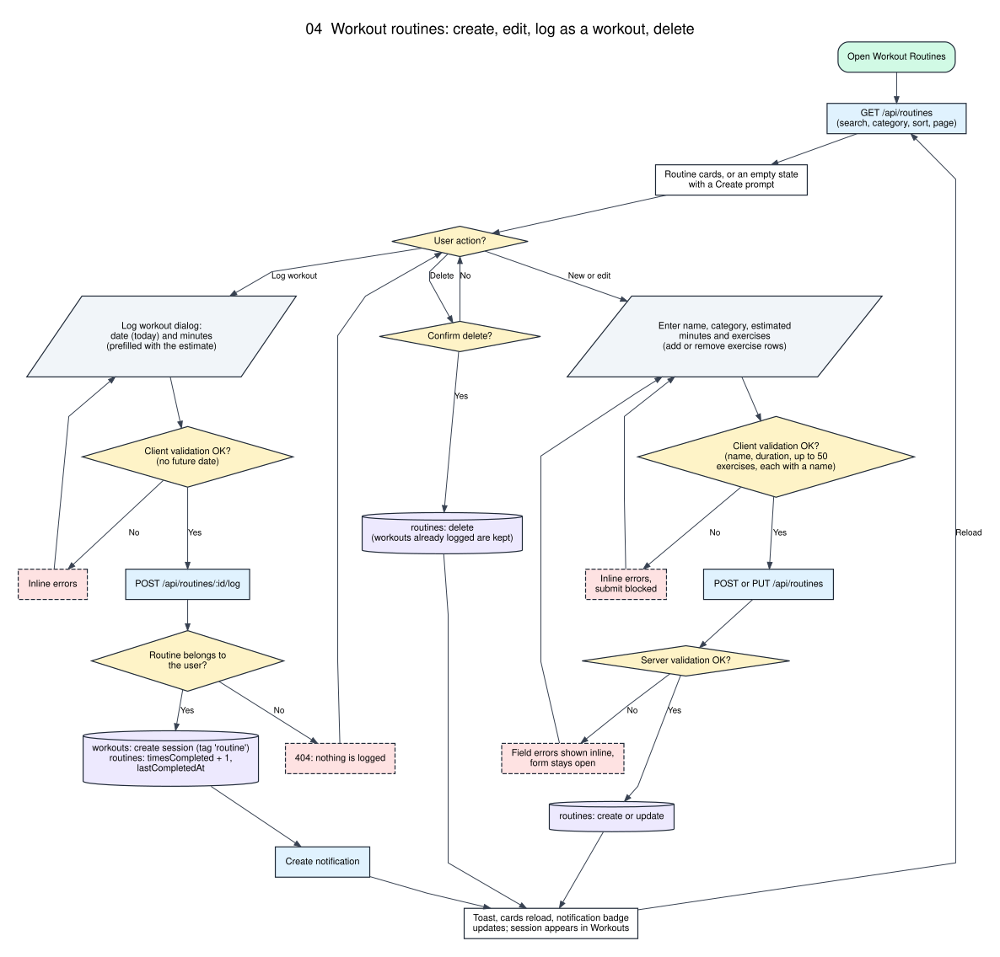
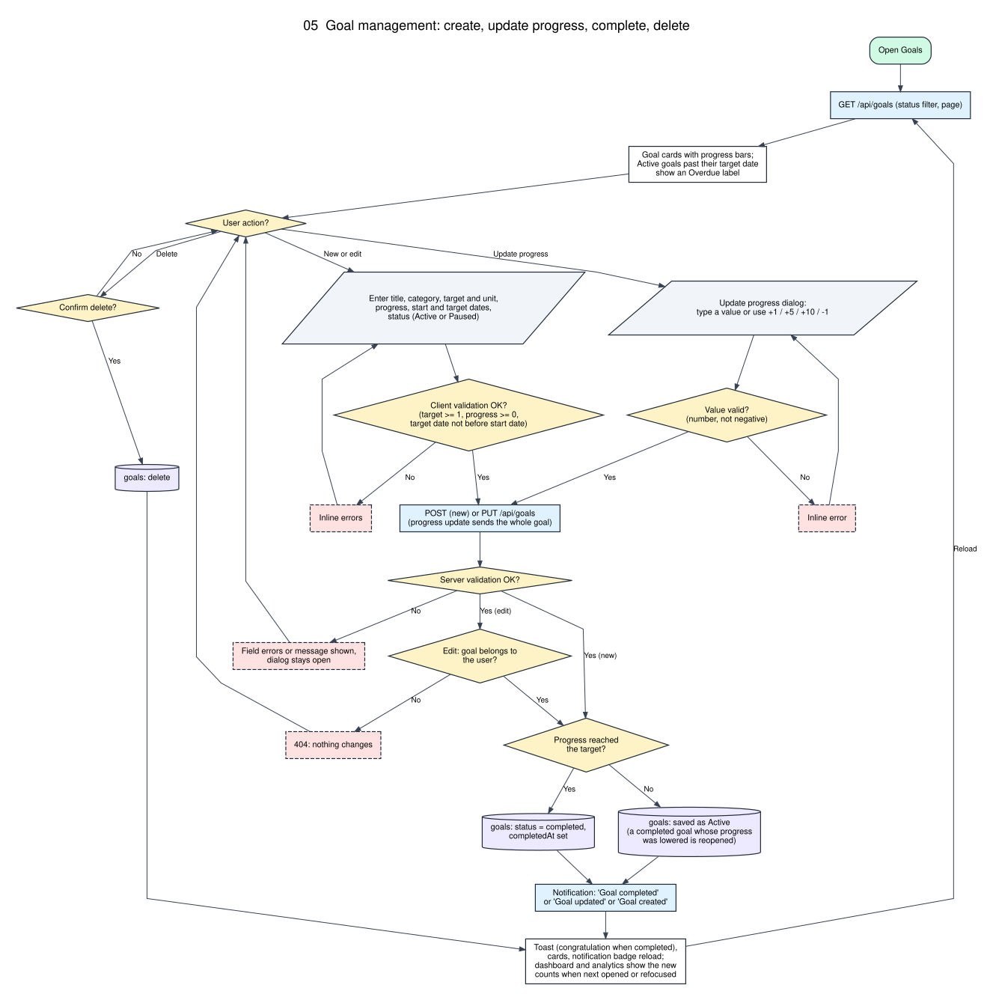
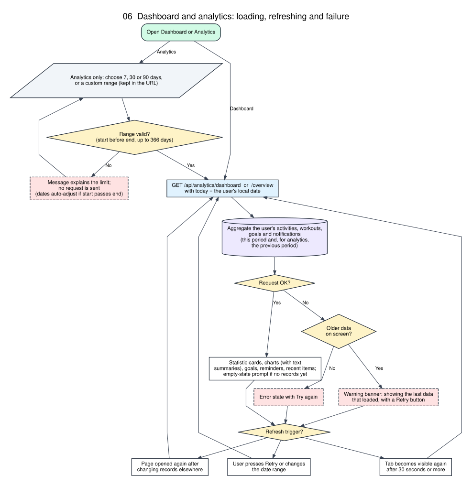
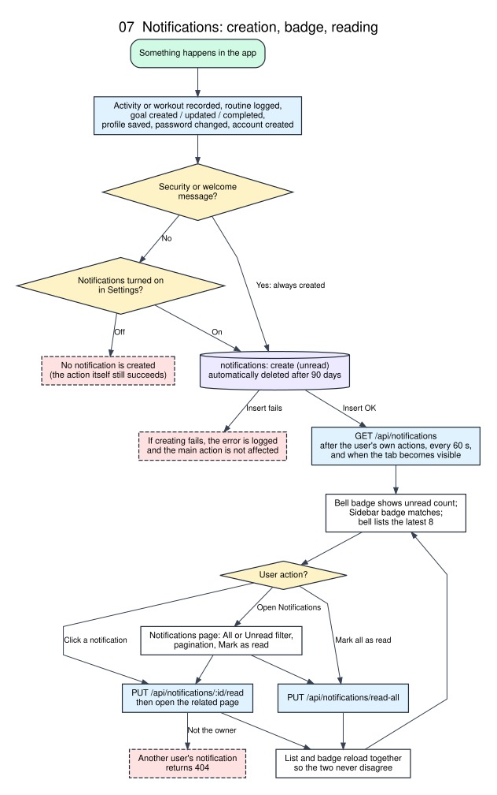
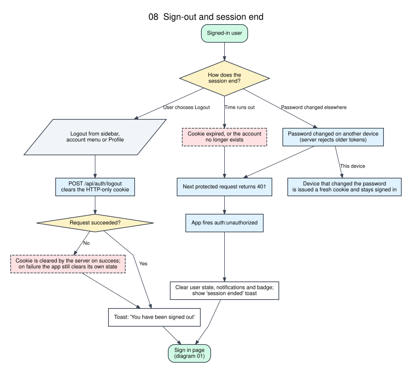

# Process flows

Eight diagrams describe how each workflow runs through the screen, the API, validation, business logic and the database.
The `.dot` files in `docs/diagrams/src/` are the editable source; the SVG and PNG files in `docs/diagrams/rendered/` are generated from them.

```bash
# needs Graphviz (https://graphviz.org), check with: dot -V
npm run docs:diagrams
```

**Notation.** Green rounded = start or end. White = screen or user step. Blue = API or server step. Amber diamond = decision.
Purple cylinder = database. Red dashed = error or recovery. Grey parallelogram = user input.
Each file begins with the same short style header so that any file opens and renders on its own.

**Keeping this in step with the code.** When you change a workflow, edit the matching `.dot` file and the trace table below in the same
commit. The route list is generated and checked automatically (`npm run docs:check`, see [API-ROUTES.md](API-ROUTES.md)).
Limits quoted below are the production values; outside production the rate limits are ten times higher.

---

## 01 Account access: session check, sign in, register

  
Source: [01-account-access.dot](diagrams/src/01-account-access.dot)

| Layer | What happens |
|---|---|
| Screen | `AuthContext` calls `GET /auth/me` on load. `ProtectedRoute` sends visitors without a session to `/login` and remembers the page they wanted. `Login.jsx`, `Register.jsx`. |
| Client validation | Zod schemas in `validations/schemas.js`, checked when a field is left and again as the user types. `useApiForm` ignores a second submit while one is running. |
| API | `POST /auth/login`, `POST /auth/register`, `GET /auth/me`. |
| Server validation | `validators/auth.validator.js`. Rate limits: 10 failed sign-ins per 15 minutes, 10 registrations per hour, 50 auth requests per 15 minutes. |
| Business logic | `services/auth.service.js`. The same error is returned for an unknown email and a wrong password, and a dummy bcrypt comparison keeps the timing similar. `utils/token.js` signs the JWT and sets the HTTP-only cookie. |
| Database | `users` (create, `lastLoginAt`), `notifications` (welcome message). |

## 02 Password reset

  
Source: [02-password-reset.dot](diagrams/src/02-password-reset.dot)

| Layer | What happens |
|---|---|
| Screen | `ForgotPassword.jsx`, then `ResetPassword.jsx` (opened from the emailed link). The reset page works whether or not the user is signed in. |
| API | `POST /auth/forgot-password`, `POST /auth/reset-password`. Both limited to 5 requests per hour. |
| Business logic | The reply never reveals whether an email is registered. Only the SHA-256 hash of the token is stored, valid for 15 minutes. Without SMTP in development, the link is shown on the page and printed in the server console. In production without SMTP, no email is sent; the failure is logged but the link never is. |
| Database | `users`: reset token hash and expiry, then new password hash and `passwordChangedAt`. `notifications`: password changed. |
| Side effect | `middleware/auth.js` rejects any token issued before `passwordChangedAt`, so other devices are signed out. |

## 03 Activity and workout records

  
Source: [03-activity-and-workout-records.dot](diagrams/src/03-activity-and-workout-records.dot)

| Layer | What happens |
|---|---|
| Screen | `RecordsPage.jsx` is shared by Activities and Workouts (configured in `pages/Activities.jsx` and `pages/Workouts.jsx`). `useResourceList` holds filters, debounced search and paging. `RecordForm.jsx` is the create and edit dialog. |
| API | `GET /activities` or `/workouts` (list), `/stats`, `POST`, `PUT /:id`, `DELETE /:id`, `GET /activities/export`. |
| Validation | Client: `makeRecordSchema`. Server: `validators/resource.validator.js` (title, category from the allowed list, 1-1440 minutes, up to 10 tags, **date not in the future**). The list query rejects an end date before the start date. |
| Business logic | `controllers/crud.factory.js` builds every handler. All queries include the signed-in user's ID, so another user's record returns 404. Updates use `doc.save()` so model validation runs. |
| Database | `activities`, `workouts`, `notifications`. Shared fields are defined once in `models/fragments.js`. |
| Refresh | After any change the list, the statistics and the notification badge reload together. If the last item on a page is removed, the list steps back one page. |

## 04 Workout routines

  
Source: [04-routines.dot](diagrams/src/04-routines.dot)

| Layer | What happens |
|---|---|
| Screen | `Routines.jsx`: routine cards, `RoutineForm` (dynamic exercise rows), `LogModal`. |
| API | `GET/POST /routines`, `GET/PUT/DELETE /routines/:id`, `POST /routines/:id/log`. |
| Validation | Name and category required, 1-1440 minutes, up to 50 exercises each with a name. Logging also rejects a future date. |
| Business logic | `controllers/routine.controller.js` `logRoutine` creates a workout from the routine (tagged `routine`), then increments `timesCompleted` and sets `lastCompletedAt`. |
| Database | `routines`, `workouts`, `notifications`. Deleting a routine keeps the workouts already logged from it. |

## 05 Goal management

  
Source: [05-goals.dot](diagrams/src/05-goals.dot)

| Layer | What happens |
|---|---|
| Screen | `Goals.jsx`: status filter, cards with progress bars, an Overdue label for Active goals past their target date, `GoalForm`, `ProgressModal`. |
| API | `GET/POST /goals`, `GET/PUT/DELETE /goals/:id`. A progress update is a full `PUT`. |
| Validation | Target 1-100000, progress not negative, target date not before the start date (client and server). |
| Business logic | The goal model's save hook sets the goal to Completed when progress reaches the target, and reopens a completed goal whose progress is lowered. The controller then sends "Goal completed" or "Goal updated". |
| Database | `goals`, `notifications`. |
| Refresh | The dashboard and analytics read goal counts when opened and when the tab regains focus. |

## 06 Dashboard and analytics

  
Source: [06-dashboard-and-analytics.dot](diagrams/src/06-dashboard-and-analytics.dot)

| Layer | What happens |
|---|---|
| Screen | `Dashboard.jsx`, `Analytics.jsx`. The analytics range is stored in the URL (`?range=30`, or `?range=custom&from=...&to=...`). |
| API | `GET /analytics/dashboard`, `GET /analytics/overview` (and `/weekly`, `/monthly`, `/activity-distribution`). The client sends `today` (its local date) so time windows follow the user's day. |
| Validation | Range of at most 366 days; a start after the end is swapped on the server and auto-adjusted in the interface. |
| Business logic | `services/analytics.service.js` aggregates the user's own records. New records cannot be dated more than one day ahead (the slack covers time zones), so totals and charts cover the same data. |
| Failure | With older data on screen a warning banner offers Retry. Without data an error state offers Try again. |
| Charts | Each chart has a plain-text summary for screen readers. |

## 07 Notifications

  
Source: [07-notifications.dot](diagrams/src/07-notifications.dot)

| Layer | What happens |
|---|---|
| Creation | `services/notification.service.js` never throws, so a failed notification cannot break the action that triggered it. It respects the Settings switch, except for the welcome message and security messages. |
| Screen | `NotificationContext` loads the latest 8 after the user's own actions, every 60 seconds, and when the tab becomes visible. The bell, the sidebar badge and the page share this state. |
| API | `GET /notifications`, `PUT /notifications/:id/read`, `PUT /notifications/read-all`. |
| Database | `notifications` (deleted automatically after 90 days). |

## 08 Sign-out and session end

  
Source: [08-sign-out-and-session-end.dot](diagrams/src/08-sign-out-and-session-end.dot)

| Layer | What happens |
|---|---|
| Screen | Logout in the sidebar, account menu and Profile page. Any 401 from a protected endpoint fires the `auth:unauthorized` event, which clears the user and shows a message. |
| API | `POST /auth/logout` clears the cookie. If that request fails the app still clears its own state. |
| Password change | `PUT /profile/change-password` stores a new hash and `passwordChangedAt`, and issues a fresh session cookie to the device that made the change. |
